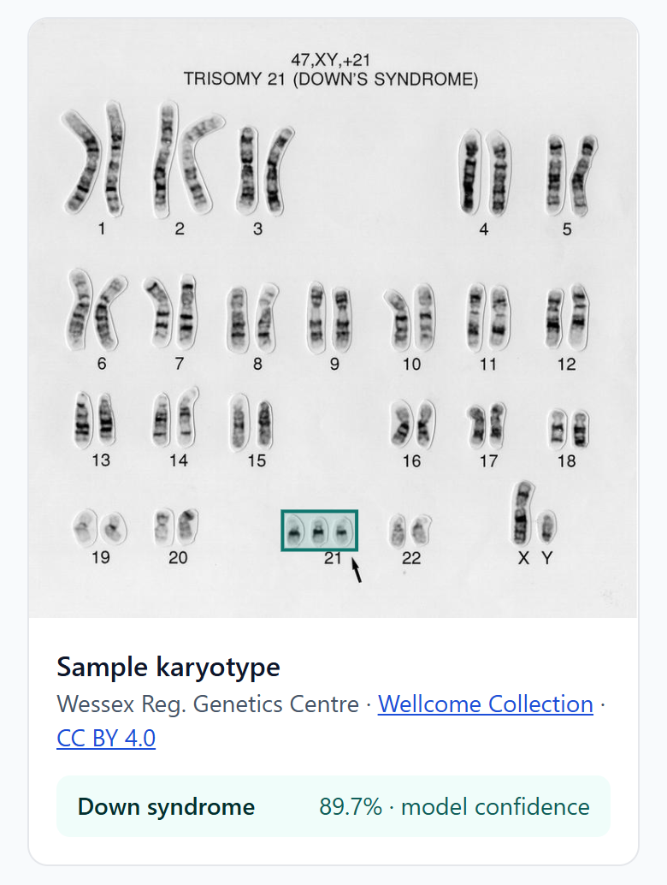

# Genome X

Genome X is a computer vision research demo for karyotypes, images of chromosomes arranged in groups. It draws boxes around regions the model associates with Down, Edwards, or Patau syndrome and shows a confidence score for each detection.

[Try the live scan in English](https://genome-x-karyotype.pages.dev/?lang=en#scan) · [April 2026 presentation excerpt](docs/recognition/genome-x-april-2026-prototype-excerpt.mp4?raw=true)

**Second place**, International Olympiad “Artificial Intelligence in Healthcare and Education,” April 17, 2026, at Asfendiyarov Kazakh National Medical University. [Recognition](#recognition)



*Live browser inference on the built-in sample. The box highlights the group of three copies of chromosome 21. Select **Try a sample** to run the scan.*

## From the April prototype to the June model

My teammate and I presented a YOLOv8 prototype and showed the original Genome X web interface in April. I wrote the model and web integration code, trained and tested the detector, and built the interface. My teammate defined the research question, led the medical review and dataset preparation, and coordinated project resources. The April deck records both contributions and credits our scientific supervisor.

In June, I fine-tuned YOLO11n on the same detection task. The public demo downloads an ONNX export of my June 5 checkpoint and runs it in a Web Worker with ONNX Runtime Web. Images stay on the visitor’s device. The local FastAPI server runs the original PyTorch checkpoint.

## What the model returns

Each detection has a class, a confidence score, and a bounding box in pixels of the oriented input image. In the public examples, the model marks the chromosome 21 group for `down_syndrome`, 18 for `edwards_syndrome`, and 13 for `patau_syndrome`. The model has three classes and no normal class. An empty result means that no box passed the confidence threshold.

Both inference paths use a 640-pixel inference size. The browser reads image orientation, scales the longest side to 640 pixels, and pads to a multiple of the model’s stride. The exported graph filters candidate boxes using a 0.25 confidence threshold and non-maximum suppression. The browser then removes the padding offsets, scales the remaining boxes back to image pixels, and renders them over the image.

## Evaluation and limitations

The June checkpoint recorded **0.960 box mAP@0.50** and **0.8495 box mAP@0.50:0.95** on the Ultralytics training run’s **validation split**. The confusion matrix shows 15 annotated boxes, four unmatched predictions, and one missed box. The validation image count, split method, and performance on an independent test set remain unverified. Clinical performance has not been established. The April slides report image-level metrics, so a comparison would need the same held-out images and box metrics for both models.

[June box precision–recall curve](docs/evaluation/june-box-pr-curve.png) · [June box confusion matrix](docs/evaluation/june-confusion-matrix.png)

The built-in sample shows an already arranged karyotype with printed chromosome labels. Its overlap with the training data is unknown. Use public or synthetic images for this research demo. The model can miss or mislabel regions, and its confidence scores do not establish a diagnosis.

The June training configuration references the Roboflow dataset export `genome-x-visualmodel/2`. The public site runs the June ONNX export directly in the browser. The relationship between the June weights and any Roboflow-hosted model is unverified.

## Run locally

Use Python 3.12 and Node.js 22.12 or later. You can install the dependencies and start the React frontend from source. **Local inference requires a separately supplied `best.pt` checkpoint.** The repository has no checkpoint download. [Try inference in the live browser demo](https://genome-x-karyotype.pages.dev/?lang=en#scan).

```bash
python -m pip install -r backend/requirements.txt
# Requires best.pt at backend/best.pt or a checkpoint path in MODEL_PATH
python -m uvicorn main:app --app-dir backend --host 127.0.0.1 --port 8000
```

In a second terminal:

```bash
cd frontend
npm ci
npm run dev
```

Open [the local frontend](http://localhost:5173/?lang=en#scan). The upload and sample controls need the running FastAPI server. A local browser build needs an ONNX export of the checkpoint. See [deployment and verification](docs/deployment.md) for the browser build, checkpoint hash, and hosting details.

## Recognition

Genome X placed second in the April 17, 2026 international olympiad in Almaty. The H. Dosmukhamedov School of Public Health and the Department of Information and Communication Technologies are named on the diploma. [KazNMU’s published results](https://publichealth.kaznmu.edu.kz/en/%D0%BD%D0%B0%D1%83%D1%87%D0%BD%D0%BE-%D0%B8%D1%81%D1%81%D0%BB%D0%B5%D0%B4%D0%BE%D0%B2%D0%B0%D1%82%D0%B5%D0%BB%D1%8C%D1%81%D0%BA%D0%B0%D1%8F-%D1%80%D0%B0%D0%B1%D0%BE%D1%82%D0%B0-%D1%81%D1%82%D1%83-19/)

- [Original April slides (PDF)](docs/recognition/genome-x-april-2026-slides.pdf)
- [April presentation excerpt showing the original interface (MP4, 19 seconds)](docs/recognition/genome-x-april-2026-prototype-excerpt.mp4?raw=true)
- [Second-place certificate with personal identifiers redacted (PDF)](docs/recognition/genome-x-second-place-certificate-redacted.pdf)

## Sample credit

The demo bundles the 760-pixel version of *Down syndrome human karyotype 47,XY,+21* by Wessex Reg. Genetics Centre. The screenshot adds the predicted box over the image. [Wellcome Collection record](https://wellcomecollection.org/works/wmcdanw6) · [CC BY 4.0](https://creativecommons.org/licenses/by/4.0/)
